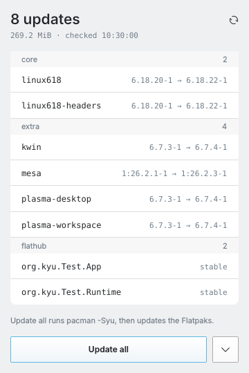
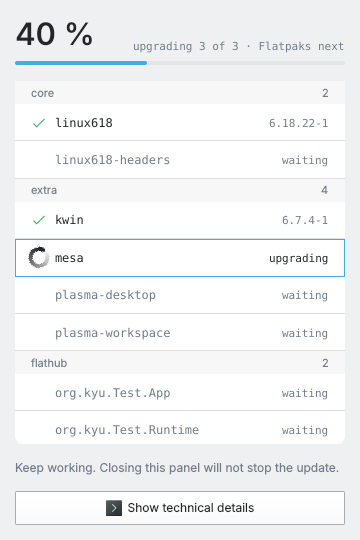
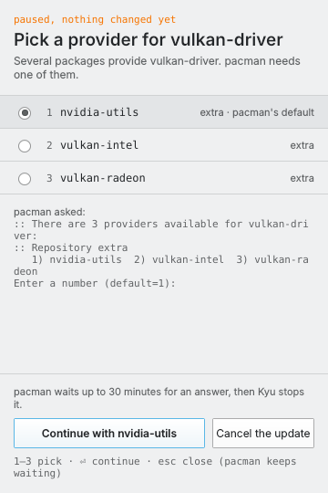
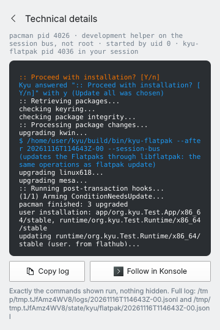
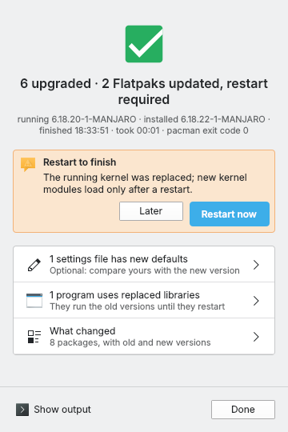
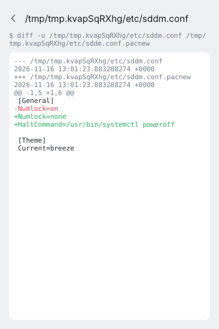
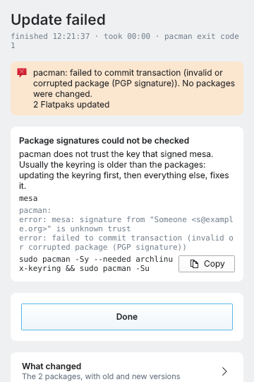

# Kyu

A KDE-native updater for Arch-based systems: a tray icon showing the number of pending repo and Flatpak updates, and (in later milestones) a panel that applies them through a privileged helper. Design and milestones: [`docs/HANDOFF.md`](docs/HANDOFF.md).

Current state: milestone 7. The tray icon shows pending repo and Flatpak updates, and clicking it opens the update panel: the list grouped by repo and remote, "Update all", live progress per package, and the output. A privileged helper runs `pacman -Syu`; then `kyu-flatpak` updates the Flatpaks through libflatpak in your session. When pacman asks something (a provider, a conflict, a replacement, a key import), the panel shows the question with pacman's own text and default, and passes the answer back. The panel can close or crash without affecting either part, and picks the update up again when reopened, including a question still waiting for an answer. Before an update, the list marks the package of the running kernel ("restart") and shows the distro's news published since the last full upgrade. Afterwards, it says whether a restart is required, and why (running vs installed kernel, systemd using replaced libraries). It also lists the programs still running replaced libraries and the settings files pacman left as `.pacnew`/`.pacsave`, with a diff view. When an update fails, the panel says why from pacman's own lines (no network, an out-of-date mirror, keyring, files already on disk, disk space, dependencies) with the command that usually fixes it. It also notices an update that was interrupted, and removes pacman's lock file only when no running process holds it.

| List | Updating | Question | Output | Done | Settings file | Failed |
|---|---|---|---|---|---|---|
|  |  |  |  |  |  |  |

The news items in the screenshots are sample data.

The screenshots come from `tools/preview-panel.sh` with a fake pacman and a stand-in for Kirigami (Breeze colours, Fusion controls). On Plasma the panel uses the real Kirigami, your colour scheme and Plasma's control style.

## Components

| Path | What it is |
|---|---|
| `src/checker` | `kyu-check`: runs `checkupdates` and libflatpak, marks the running kernel's package, fetches the distro's news since the last full upgrade, writes `$XDG_STATE_HOME/kyu/updates.json`. Never needs root. |
| `src/tray` | `kyu-tray`: StatusNotifierItem with the update count; reads the state file. |
| `src/core` | Shared code: parsers, state file, checks. |
| `helper` | `kyu-helper` (Rust): the only code that runs as root. D-Bus service behind polkit; runs `pacman -Syu`, streams progress, writes `/var/log/kyu/*.jsonl`. Protocol: [`docs/helper-protocol.md`](docs/helper-protocol.md). |
| `src/flatpak` | `kyu-flatpak`: updates every Flatpak with an update (system and user installations) through libflatpak, in the user's session, writing `$XDG_STATE_HOME/kyu/flatpak/*.jsonl`. With `--after TX` it waits for that pacman transaction first. |
| `src/client` | `HelperClient` (Qt) and `kyu-update`, a terminal client that starts a pacman update or reattaches to one (pacman only; Flatpaks go through the panel or `kyu-flatpak`). |
| `src/panel` | `kyu`: the update panel (Qt Quick, Kirigami). `PanelController` holds the state and actions; `qml/` only lays them out. Single instance: starting it again raises the open one. |
| `data` | systemd units, XDG autostart entry, D-Bus activation and bus policy, polkit action, interface XML. |

## Dependencies

Runtime: `pacman-contrib` (for `checkupdates`), `flatpak` (libflatpak), Qt 6 (with Qt Quick Controls), KF6 StatusNotifierItem, Kirigami, the Plasma Qt Quick Controls style (`qqc2-desktop-style`), polkit and a polkit agent (Plasma has one).

Tests also use `dbus-run-session`, `gdbus` and the `flatpak` command; tests whose tools are missing are left out.

Build: CMake ≥ 3.22, a C++20 compiler, Qt 6 (Core, Gui, Widgets, DBus, Quick, QuickControls2, Test), libflatpak, KF6StatusNotifierItem, Rust ≥ 1.89 with cargo, Corrosion (fetched from GitHub if not installed). `-DKYU_HELPER=OFF` builds without the helper.

On Arch:

```bash
sudo pacman -S --needed base-devel cmake ninja rust corrosion qt6-base qt6-declarative kirigami qqc2-desktop-style kstatusnotifieritem flatpak pacman-contrib
```

## Build and test

```bash
cmake -S . -B build -G Ninja -DKYU_REQUIRE_KSNI=ON
```

```bash
cmake --build build
```

```bash
ctest --test-dir build --output-on-failure
```

Without KF6, drop `-DKYU_REQUIRE_KSNI=ON`; the tray then falls back to `QSystemTrayIcon`. `-DKYU_FLATPAK=OFF` builds without libflatpak (Flatpaks are then reported as not checked).

## Try it from the build tree

```bash
build/bin/kyu-check --json
```

```bash
build/bin/kyu-tray
```

```bash
build/bin/kyu
```

The helper test (`helper_session`) runs `kyu-helper --session` with a fake pacman on a private bus. It covers:

- killing the client mid-update and reattaching
- a second start while one is running
- pacman's lock file
- each question type: answered, defaulted, refused, cancelled, timed out, answered over D-Bus by another client, and answered by a client that attached late
- an unrecognised question (fails closed)
- pacman failures
- SIGTERM during an update
- a helper killed mid-update

The Flatpak test (`flatpak_update`) uses real libflatpak: it builds a local repository and a throwaway installation with the `flatpak` command, then covers updating apps and runtimes, nothing to do, an unreachable remote (reported as a failure, not as "no updates"), one runner at a time, waiting for pacman with `--after`, and skipping the Flatpaks when the pacman update is cancelled.

`kyu-update` asks pacman's questions on the terminal: type an answer, press Enter for pacman's default, or type `c` to cancel.

To try the helper without root, on your session bus, with a pacman stand-in:

```bash
build/bin/kyu-helper --session --pacman tests/helper/fake-pacman --db-lock /tmp/kyu-db.lck --log-dir /tmp/kyu-logs
```

```bash
build/bin/kyu-update --session
```

Press Ctrl+C in `kyu-update` while it runs, then follow the same update again:

```bash
build/bin/kyu-update --session --attach
```

The panel works against the same development helper (the option is `--session-bus`, because Qt reserves `-session` for X11 session management):

```bash
build/bin/kyu --session-bus
```

### Panel previews without KF6

Configure with `-DKYU_PREVIEW=ON` to build the panel with a stand-in for the few Kirigami types it uses, then script screenshots (offscreen, private bus, fake pacman):

```bash
cmake -S . -B build -DKYU_PREVIEW=ON
```

```bash
tools/preview-panel.sh /tmp/running.png --start-update --delay 3300
```

The script's header lists more examples (dark colours, output page, questions with `MODE=provider|conflict|replace|key`, `--answer VALUE`). Never package a preview build.

`kyu-check` exits 0 when every source was checked, 2 when one failed (the error is printed and stored in the state file), 1 when the state file could not be written.

Without the installed systemd units, the tray runs `build/bin/kyu-check` itself: one minute after start, then hourly. "Check for updates now" in the tray menu runs it at once. Set `KYU_NO_SYSTEMD=1` to force this mode when the units are installed.

## Install

```bash
sudo cmake --install build
```

This installs the binaries (`kyu-helper` into libexec), the systemd units, the D-Bus and polkit files and `/etc/xdg/autostart/io.github.solarizeddev.kyu.tray.desktop`. At the next login the tray starts and starts `kyu-check.timer`. To check on a timer without the tray:

```bash
systemctl --user enable --now kyu-check.timer
```

After installing, D-Bus needs to reread its configuration once so it sees the helper's bus policy (a reboot also does it):

```bash
sudo systemctl reload dbus
```

Then click the tray icon (or start `kyu`) and choose "Update all". polkit asks for your password. From a terminal:

```bash
kyu-update
```
